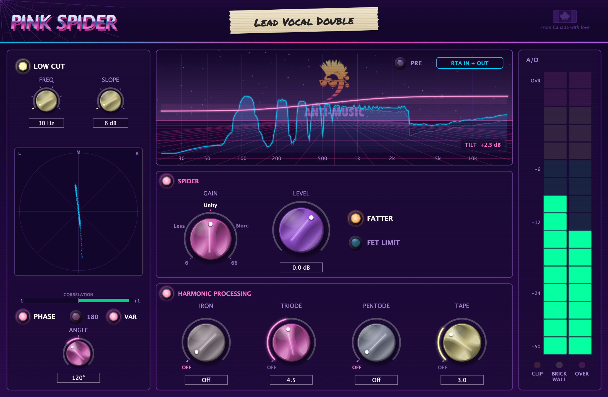
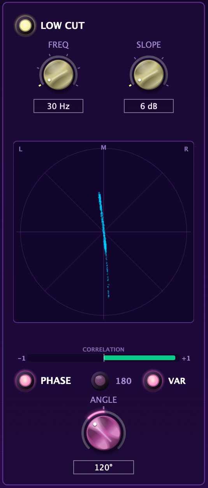
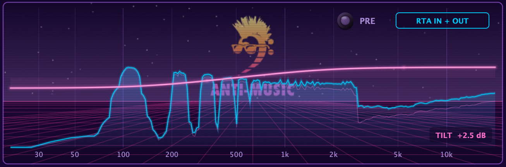
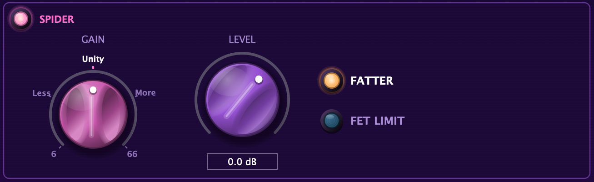
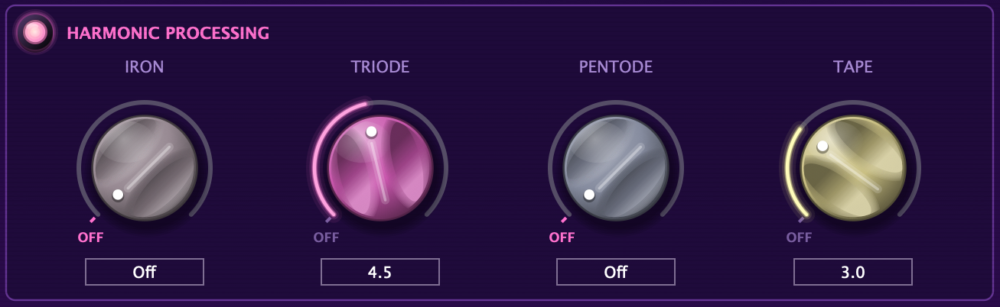
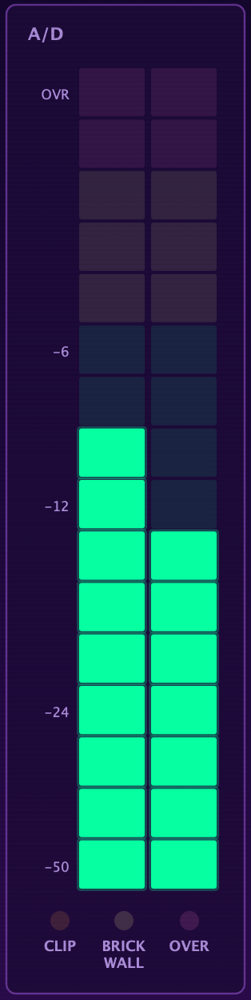

# Pink Spider manual

**Pink Spider by Anti-Music**: console preamp, FET limiter, A/D and analog harmonics, in one plugin. Beta version.

> [!TIP]
> This manual is also a designed, printable PDF: **[download Pink-Spider-Manual.pdf](https://github.com/BigDumbRobot/Pink-Spider-Beta/raw/main/docs/Pink-Spider-Manual.pdf)**.



**Contents**

1. [Install](#1-install)
2. [Quick start](#2-quick-start)
3. [How the sound flows](#3-how-the-sound-flows)
4. [Low cut and phase](#4-low-cut-and-phase)
5. [Display and tilt EQ](#5-display-and-tilt-eq)
6. [The Spider section](#6-the-spider-section)
7. [FET LIMIT](#7-fet-limit)
8. [Harmonic processing](#8-harmonic-processing)
9. [Meter and lights](#9-meter-and-lights)
10. [Sounds to try](#10-sounds-to-try)
11. [Troubleshooting and uninstall](#11-troubleshooting-and-uninstall)
12. [Reporting bugs and feedback](#12-reporting-bugs-and-feedback)

---

## 1. Install

### What you need

| | |
|---|---|
| **Mac** | macOS 11 Big Sur or newer, Apple Silicon or Intel. A DAW that loads **VST3** or **Audio Units** (Logic Pro, GarageBand, Ableton Live, Cubase, Reaper, Studio One, Bitwig, FL Studio...). |
| **Windows** | Windows 10 or 11, 64-bit. A DAW that loads **VST3**. |

Download the installer for your computer from the **[Releases page](https://github.com/BigDumbRobot/Pink-Spider-Beta/releases/latest)**:

- Mac: `Pink-Spider-<version>-macOS.pkg`
- Windows: `Pink-Spider-<version>-Windows-Setup.exe`

### Mac

1. **Quit your DAW.**
2. **Double-click the installer.**
3. If macOS says it *can't be opened* or *Apple could not verify* it, click **Done**. Open **System Settings → Privacy & Security**, scroll down to the message about the Pink Spider installer, and click **Open Anyway**. Enter your password and click **Open**.
4. **Follow the installer.** It installs both the VST3 and the Audio Unit. Click **Customize** if you only want one.
5. **Open your DAW** and look for **Pink Spider** under **Anti-Music**.

> [!NOTE]
> Beta installers aren't signed by Apple yet, so macOS asks you to confirm. That's expected, and only happens the first time. On macOS 12 and earlier you can instead **right-click** the installer and choose **Open**.

### Windows

1. **Quit your DAW.**
2. **Double-click the installer.**
3. If you see **"Windows protected your PC"**, click **More info**, then **Run anyway**.
4. Click **Yes** to allow changes, accept the beta licence, then click **Install**.
5. **Open your DAW** and rescan plugins if needed. Pink Spider is listed under **Anti-Music**.

### Updating

Run the new installer. It replaces the old version, and your sessions keep their settings.

---

## 2. Quick start

1. **Put Pink Spider on a track, first in the chain.** When it opens it does *nothing* to your sound: everything starts off or neutral.
2. **Add colour.** Turn **TRIODE** or **TAPE** up to about **4**.
3. **Thicken it.** Light **FATTER** for a warmer, fuller middle.
4. **Drive the preamp.** Click **GAIN** to **More**, then pull **LEVEL** down until it's as loud as before.
5. **Control it.** Light **FET LIMIT** for 1176-style attitude.

> [!TIP]
> Click the round lens next to **SPIDER** or **HARMONIC PROCESSING** to switch that whole section off and on. It's the fastest way to hear what it's doing.

**Handy everywhere:** drag a knob up or down to turn it, or click its value box to type a value. **Double-click** a knob to reset it. A lit lens means on.

---

## 3. How the sound flows

```
 IN ─► PHASE ─► GAIN ─► LEVEL ─► LOW CUT ─► FATTER ─► BRICK WALL ─► FET LIMIT ─► A/D
                                                                                  │
 OUT ◄─ TILT EQ ◄─ TAPE ◄─ PENTODE ◄─ TRIODE ◄─ IRON ◄─────────────────────────────┘
```

> [!IMPORTANT]
> **LEVEL comes before the limiters and the A/D.** It decides how hard you hit FET LIMIT, BRICK WALL and the converter. Turning LEVEL up means more limiting, not only more volume.

The tilt EQ runs last. Light **PRE** to put it first instead.

---

## 4. Low cut and phase



| Control | What it does |
|---|---|
| **LOW CUT** | Switches the low cut in or out. It starts out. |
| **FREQ** | 30, 50, 80, 100, 160 or 300 Hz. |
| **SLOPE** | 6, 12, 18 or 24 dB per octave. Bigger numbers cut harder. |
| **Phase scope** | Your stereo image. A vertical line is mono, spread sideways is wide, lying flat is out of phase. |
| **CORRELATION** | +1 is mono, around 0 is very wide, left of centre is out of phase. |
| **PHASE** | Switches the phase section in or out. |
| **180** | Flips the waveform upside down. |
| **VAR** + **ANGLE** | Rotates the phase from 0° to 360°. It clicks into place at 180°. |

**Try:** low cut on vocals at 80–100 Hz, 12 dB. For two mics on one source, try **180**, or pick **VAR** and sweep **ANGLE** until the low end sounds fullest.

<br clear="right">

---

## 5. Display and tilt EQ



The spectrum shows your sound **before** (faint purple) and **after** (bright blue) Pink Spider. **Click the label** in the top-right corner to switch between IN + OUT, IN, OUT and OFF.

The **tilt EQ** works like a seesaw around 500 Hz, up to ±6 dB at each end:

| Do this | Result |
|---|---|
| Hold **Shift** and drag **up** on the spectrum | Brighter: more treble, less bass |
| Hold **Shift** and drag **down** | Darker: more bass, less treble |
| **Right-click → Reset Tilt** | Back to flat |

**PRE** moves the tilt EQ to the start of the chain, so it changes what goes into the preamp and harmonics.

---

## 6. The Spider section



| Control | What it does |
|---|---|
| **SPIDER** lens | Switches the whole section in or out. Low cut, phase and harmonics keep working. |
| **GAIN** | The console preamp. Five clicks, starting at Unity. |
| **LEVEL** | Channel output, −60 to +12 dB. Sets how hard the limiters and the A/D are hit. |
| **FATTER** | A tube stage: thicker and warmer, mostly 2nd harmonic. |
| **FET LIMIT** | An 1176-style limiter in front of the converter. See [chapter 7](#7-fet-limit). |

| GAIN | 6 | Less | **Unity** | More | 66 |
|---|:---:|:---:|:---:|:---:|:---:|
| Into the preamp | −30 dB | −15 dB | **no change** | +15 dB | +30 dB |

> [!IMPORTANT]
> **GAIN up, LEVEL down.** Turn LEVEL down by about as much as you turned GAIN up, so you're comparing tone, not loudness.

---

## 7. FET LIMIT

A limiter modelled on the classic **1176 "blue stripe"**, right in front of the converter.

| Setting | Value | What you hear |
|---|---|---|
| **Ratio** | 20:1, always | Full limiting. It holds the level firmly. |
| **Attack** | Slowest (about 800 µs) | The front of each hit punches through before it clamps. |
| **Release** | Fastest (50 ms), stretching to about 120 ms when limiting hard and long | Lively and aggressive. |
| **Where it starts** | About −3 dBFS | Keeps the converter from going over. |

**How to use it:** light FET LIMIT, then turn **LEVEL** up until it grabs as hard as you like. Click GAIN to More for extra attitude. As it limits harder, it adds a little 2nd harmonic, like the real one.

> [!TIP]
> **FET LIMIT** is the sound: colour and squash. **BRICK WALL** is the safety net: it just catches peaks. You can use both.

---

## 8. Harmonic processing



Four analog colours after the converter, in this order. The lens next to the title switches all four.

| Knob | Sounds like | Reach for it on |
|---|---|---|
| **IRON** | Input transformer: thicker, tighter lows; highs stay open | Kick, bass |
| **TRIODE** | Warm, round and fat (even harmonics) | Vocals, acoustic guitar |
| **PENTODE** | Brighter, more detail, a bit of squash (odd harmonics) | Vocals that need to cut, snare, guitars |
| **TAPE** | Tape saturation: highs soften first, low-end bump | Drums, busses, harsh sources |

| | OFF | 1 to 3 | **4 to 6** | 7 to 10 |
|---|:---:|:---:|:---:|:---:|
| Sounds | Fully left, clicks in | Subtle | **Clearly coloured** | Heavy, into distortion |

These four never cause an over.

---

## 9. Meter and lights



The meter shows the peak level going into the converter: green is healthy, yellow is hot, **OVR** at the top is a digital over.

| Light | Means |
|---|---|
| **CLIP** | The preamp is pushed past its headroom. Click GAIN down a step. |
| **BRICK WALL** | **This light is also a switch: click it.** Dark is off, lit yellow is on, **red** means it's limiting right now. |
| **OVER** | The signal went over full scale. Turn LEVEL down, or light FET LIMIT or BRICK WALL. |

**BRICK WALL** is a fast peak limiter that catches peaks just below full scale, linked across both channels.

<br clear="right">

---

## 10. Sounds to try

| Source | Try this |
|---|---|
| **Lead vocal** | LOW CUT 80 Hz / 12 dB · GAIN More, LEVEL down to match · FET LIMIT · TRIODE 3 · PENTODE 2 |
| **Bass** | GAIN More · FATTER · IRON 4 · TAPE 3 · FET LIMIT |
| **Kick** | IRON 5 · TRIODE 3 · BRICK WALL |
| **Snare** | PENTODE 4 · TAPE 3 · bottom mic: 180 |
| **Acoustic guitar** | LOW CUT 100 Hz · TRIODE 3 · tilt a little brighter |
| **Electric guitar** | LOW CUT 80 Hz · PENTODE 3 · TAPE 2 |
| **Smashed room** | GAIN More · FET LIMIT · LEVEL up until it pumps · TAPE 4 |
| **Mix bus** | GAIN Unity · IRON 2 · TAPE 2 to 3 · tilt to taste |

---

## 11. Troubleshooting and uninstall

| Problem | Fix |
|---|---|
| Pink Spider doesn't show up | Restart the DAW and rescan plugins. In Logic: **Settings → Plug-in Manager**, select Pink Spider, **Reset & Rescan Selection**. |
| The Mac says the installer can't be opened | Use **Open Anyway** in **System Settings → Privacy & Security**. If it still refuses, run `xattr -d com.apple.quarantine ~/Downloads/Pink-Spider-*-macOS.pkg` in Terminal and try again. |
| It's louder or quieter | Set GAIN to **Unity** and LEVEL to **0 dB**. With FATTER, both limiters and the harmonic knobs off, it doesn't change your sound. |
| It sounds distorted | Watch CLIP and OVER. Click GAIN down, lower LEVEL, or turn the harmonic knobs down. |
| BRICK WALL is red all the time | Turn LEVEL down until it only flashes red on peaks. |
| Pro Tools | Not in this beta. The AAX version needs to be signed first. |

**Uninstall on Mac:** delete `/Library/Audio/Plug-Ins/VST3/Pink Spider.vst3` and `/Library/Audio/Plug-Ins/Components/Pink Spider.component`.
**Uninstall on Windows:** Settings → Apps → Installed apps → **Pink Spider (Anti-Music) beta** → Uninstall.

---

## 12. Reporting bugs and feedback

**[Open an issue](https://github.com/BigDumbRobot/Pink-Spider-Beta/issues/new/choose)** and pick **Bug report** or **Feedback or idea**. For bugs, please include your computer and OS version, your DAW and version, the Pink Spider version, what happened, and a screenshot if you can.

---

<sub>Pink Spider © 2026 Anti-Music. Built with JUCE. VST is a trademark of Steinberg Media Technologies GmbH. Crane Song, Spider, HEDD, UREI and 1176 are trademarks of their owners, mentioned only to describe the style of processing; Pink Spider is not affiliated with or endorsed by them. From Canada with love.</sub>
