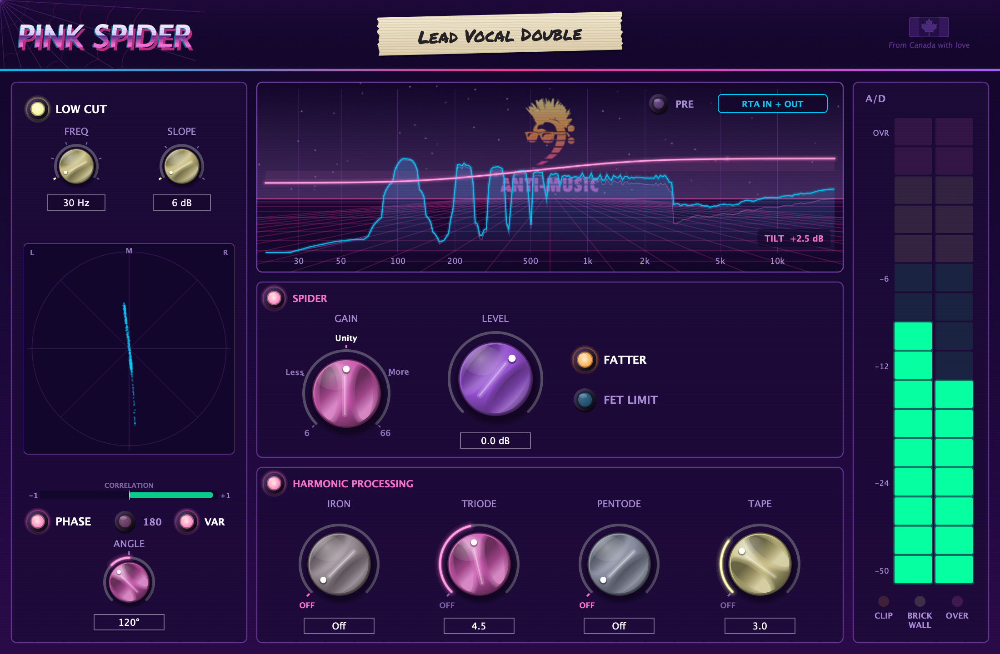

# Pink Spider (beta)

A console preamp, tube stage, FET limiter + four colours (iron, triode, pentode, tape). 

Built for any track or master bus processing.
VST3 and Audio Unit, for Mac and Windows.

## Download

**[Get the latest beta](https://github.com/lilPZmods/Pink-Spider-Beta/releases/latest)**

| Your computer | Download | Formats |
|---|---|---|
| Mac (macOS 11+, Apple Silicon or Intel) | `Pink-Spider-<version>-macOS.pkg` | VST3, Audio Unit |
| Windows (10 / 11, 64-bit) | `Pink-Spider-<version>-Windows-Setup.exe` | VST3 |

Pro Tools (AAX) in development.

## Install instructions

1. Quit your DAW and run the installer.
   - **Mac:** if macOS says it can't verify the installer, go to **System Settings → Privacy & Security** and click **Open Anyway**.
   - **Windows:** if you see "Windows protected your PC", click **More info → Run anyway**.

## Manual

**[Download the manual (PDF)](https://github.com/lilPZmods/Pink-Spider-Beta/raw/main/docs/Pink-Spider-Manual.pdf)**: install help, a tour of every control, sounds to try, and troubleshooting. It's also attached to every release.

Prefer to read it here? **[Read the manual on GitHub](MANUAL.md)**.

## Found a bug? Have an idea?

**[Report it here](https://github.com/lilPZmods/Pink-Spider-Beta/issues/new/choose)**. Tell us your computer, your DAW, and what happened. Thank you for testing!

---

Pink Spider © 2026 Anti-Music. Free beta for testing, provided as is: see [LICENSE](LICENSE.txt). From Canada with love.
